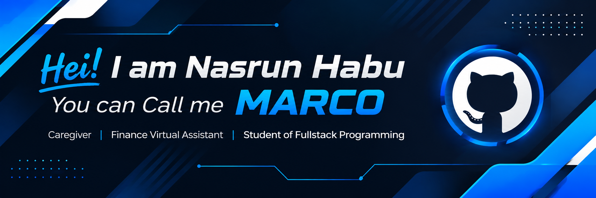

<!-- ═══════════════ HEADER ═══════════════ -->

 

 
 

<!-- SOCIAL LINKS | MARCO -->

&nbsp;

&nbsp;

&nbsp;

 
<!-- ═══════════════ ABOUT ME ═══════════════ -->

 I'm building my journey at the intersection of caregiving, financial administration, and technology. Currently, I'm learning <b>Fullstack Programming</b> and developing my understanding of modern web development. 

 

 

<!-- ═══════════════ TECH JOURNEY ═══════════════ -->

  

  <i>My skills are continuously evolving as I learn and build projects.</i>

<!-- ═══════════════ GITHUB ANALYTICS ═══════════════ -->

I'm open to learning, sharing ideas, collaborating on projects, and connecting with people who are passionate about technology and personal growth.

  

  

**Thanks for stopping by! ⭐**

*— MARCO | Nasrun Habu*

<!-- ═══════════════ END ═══════════════ -->
